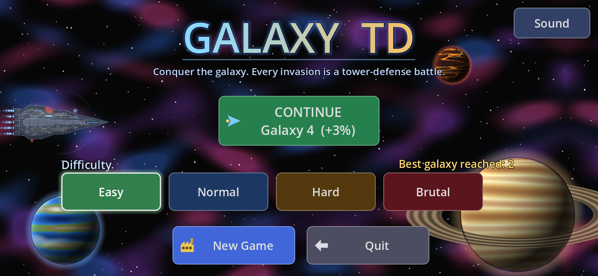
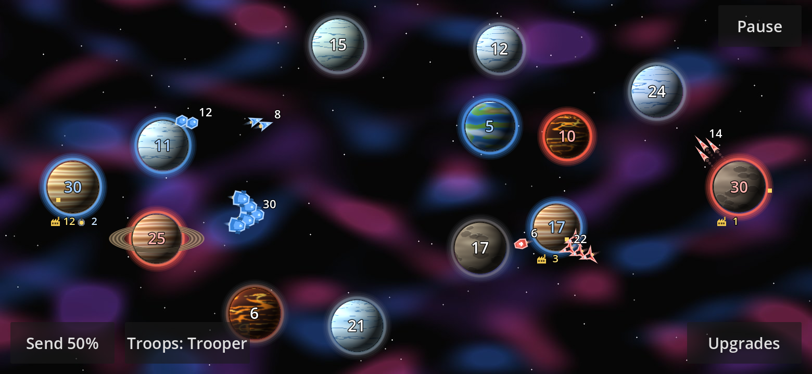
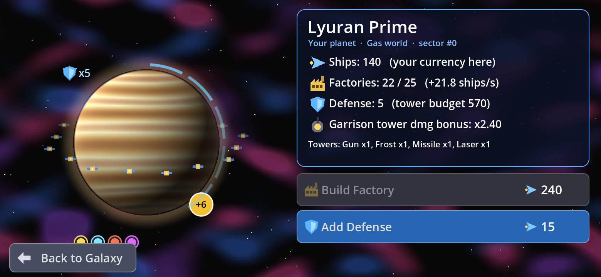
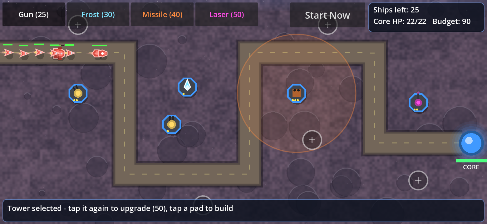
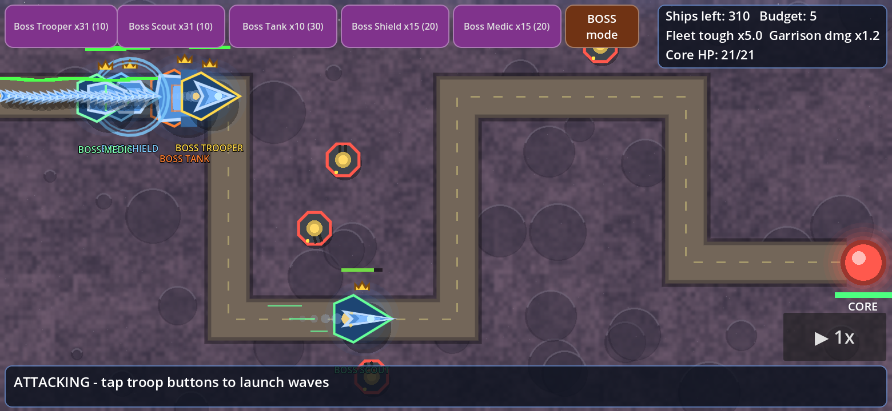
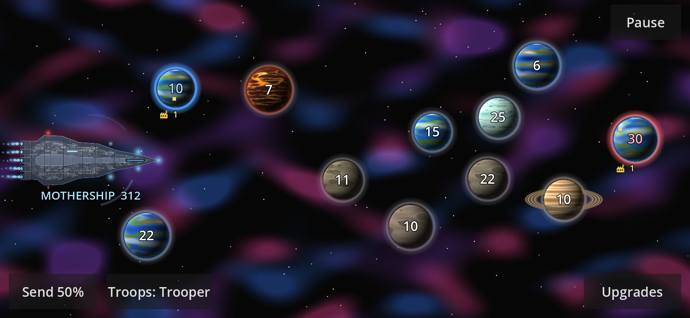
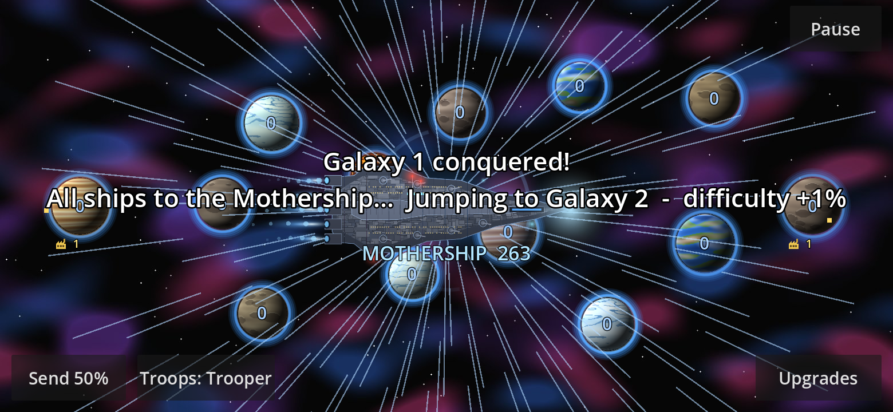
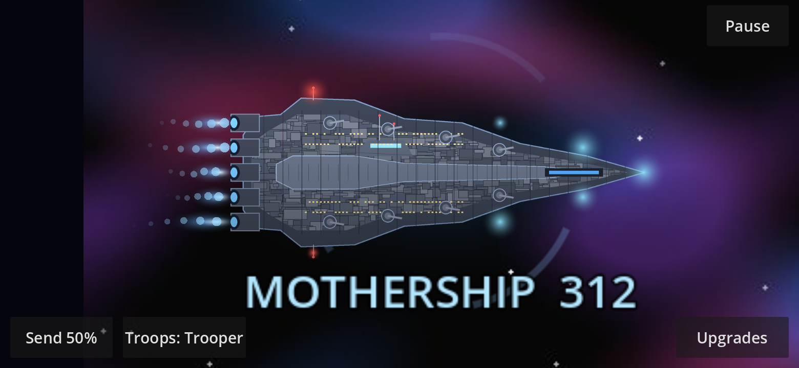
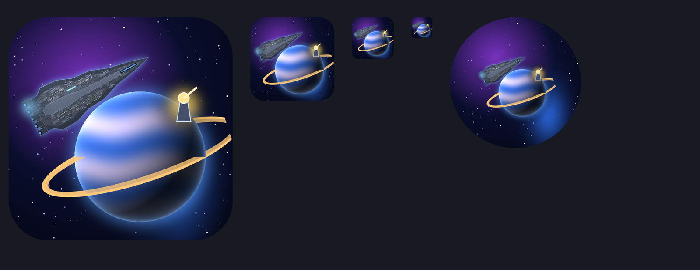

# 🌌 Galaxy TD

**Galcon-style galaxy conquest meets tower defense — built in Godot 4.3 for Android.**

Drag fleets between planets to conquer the galaxy. Every invasion of an occupied planet becomes a tower-defense battle: attack with troops and bosses, or defend with Gun, Frost, Missile and Laser towers. Conquer a galaxy and your entire armada boards the Mothership and jumps to a new, slightly harder one — forever.

<p align="center"></p>

## Screenshots

| Galaxy map | Planet menu |
|---|---|
|  |  |
| **Tower-defense battle** | **Boss units** |
|  |  |
| **Mothership arrives in a new galaxy** | **Hyperspace jump** |
|  |  |
| **Mothership close-up** | **App icon** |
|  |  |

## Features

- **Galaxy conquest** – drag from your planets to send 25/50/75/100% of their ships; procedurally shaded, rotating planets (rocky, terran, gas giant, ice, lava) with generated names.
- **Tower-defense battles** – every contested invasion is played out on a path: attackers launch troop waves (Trooper, Scout, Tank, Bomber, Shield, Medic), defenders build and upgrade towers. Bigger garrisons hit harder; bigger fleets are tougher.
- **Ships are the currency** – spend a planet's ships on factories (production) and defense (tower budget).
- **Difficulties** – Easy / Normal / Hard / Brutal.
- **Endless campaign** – conquer every planet and all ships stream into the Mothership, which jumps to a new procedurally generated galaxy, **+1% AI difficulty per galaxy**. Best galaxy reached is tracked.
- **Per-type boss units** – once you send 100+ ships, launch Boss Trooper / Scout / Tank / … (10 units in one, 10× HP & core damage, 60% speed). The AI uses them too.
- **20 upgrades** in 5 categories, including the infinite **Factory Cap** upgrade.
- **Procedural sound & music** with volume sliders and mute.
- **Battle speed** 1× / 2× / 3× / 5×, with fixed-step simulation and auto-stacking for big waves.
- **Autosave & Continue** – resume mid-galaxy or even mid-battle.

## Install on Android (sideload)

1. Download `GalaxyTD_debug.apk` from the [latest release](../../releases/latest) on your phone.
2. Open it. When prompted, allow your browser/file manager to **Install unknown apps** (Settings → Apps → Special access → Install unknown apps).
3. Tap **Install**, then launch **Galaxy TD**. Landscape, touch controls (tested on Galaxy S24 Ultra, arm64).

> The release APK is **debug-signed** for sideloading; it is not a Play Store build.

## Build from source

1. Install [Godot 4.3](https://godotengine.org/download/archive/4.3-stable/) and its **export templates** (Editor → Manage Export Templates).
2. Open this folder (`project.godot`) in Godot. Run the main scene to play on desktop.
3. For Android: install JDK 17 and the Android SDK (build-tools 34, platform 34), set their paths in *Editor Settings → Export → Android*, along with a debug keystore.
4. *Project → Export → Android → Export Project* (arm64-v8a).

Headless smoke test:

```bash
godot --headless --path . res://tests/smoke.tscn   # prints "SMOKE PASS"
```

`tools/` contains the Python (numpy + Pillow) generators used for the planet textures, mothership, icon and sound effects.
